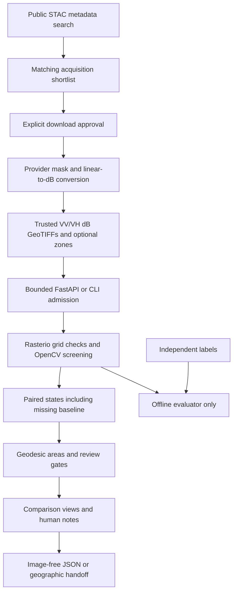

# WaterTrace submission pack — working draft

Owner decision: proceed toward AWS deployment. Provisioning awaits an approved account/profile, region and spending cap; no resources have been created. This pack is not a completed competition entry. Check [official requirements](https://opencv26.devpost.com/rules) and [submission page](https://opencv26.devpost.com/) before submitting. Do not claim a deployment, reviewed users, agentic qualification, COOL/Graviton execution or an award.

## Short pitch

WaterTrace is a satellite-evidence review workspace for a proposed farming-cooperative or NGO workflow after flooding. It separates water-like observations from missing evidence, traces comparisons to source dates and hashes, and withholds change claims where an earlier baseline is unassessable. A reviewer can inspect hard cases, annotate geographic zones and export an auditable handoff. It requires no field hardware.

The differentiation is **evidence accounting and reviewability**, not a claim to invent satellite flood mapping or outperform operational products. The agricultural workflow remains a hypothesis awaiting users and crop-specific validation.

## Technical report index

- [Architecture and algorithm](WATERTRACE_ARCHITECTURE.md): actual OpenCV filtering, Otsu, morphology, connected components and image encoding; geographic accounting and application limits.
- [Original evaluation](WATERTRACE_BENCHMARK.md): all 90 exposed chips, baseline, counts and regional failures.
- [Fixed filtered-baseline experiments](WATERTRACE_EXPERIMENTS.md): exploratory comparisons, no production-model change.
- [Real paired case](WATERTRACE_PAIR_CASE.md): public-data provenance, conversion, quality masks, 24-day interval and missing-baseline evidence; not temporal accuracy validation.
- [Hard-case guide](WATERTRACE_SHOWCASE.md): selected real replays versus explicitly synthetic contract tests.
- [Readiness](WATERTRACE_READINESS.md): unresolved validation, security, hosting and delivery conditions.

## Architecture diagram



This is the implemented local architecture. An AWS-hosted version must be labeled proposed until actually run; see the deployment checklist below.

## Demo recording script — target 4 minutes 40 seconds

1. **0:00–0:25:** Introduce the team and problem. “A satellite gap must not become a safe-field conclusion.” State research-prototype scope.
2. **0:25–1:10:** Load India. Identify acquisition date, uncertainty and an illustrative zone. Explain these are not verified farm boundaries.
3. **1:10–2:00:** Upload the Beira pair. Wipe between dates, then show change categories. Point out water with no earlier baseline and explain why it cannot be called new flooding.
4. **2:00–2:40:** Open Sri Lanka’s exposed-test failure; show missed water. Run the synthetic tiny-field or shifted-grid case and explain its limits.
5. **2:40–3:15:** Add a clearly identified demonstration reviewer note and export. Show source hashes and withheld conclusions. Do not present the note as expert/user feedback.
6. **3:15–4:05:** Explain the architecture and actual OpenCV work. Show baseline precision/recall trade-off. If and only if AWS is deployed, demonstrate a real core analysis there, not just a static page or S3 download.
7. **4:05–4:40:** State measured scope, known failures and next validation step. Show repository/setup links and give attribution.

Record actual current software; avoid simulated cloud outputs, invented users and unlicensed stock footage. Verify audio, readable captions, team identification, link access in a signed-out window and total duration. The video has **not** been recorded. Browser visual QA remains outstanding under the current access restriction.

## Real reviewer study protocol — ready, not conducted

Recruit 3–5 consenting remote-sensing/agriculture/disaster-response practitioners through owner-approved contacts. No outreach is authorized yet. Explain the research scope, optional participation and how notes will be retained; use public sample locations, not sensitive farmer data.

Use two equivalent task sets: one with source imagery plus ordinary map/metadata review, one with WaterTrace. Counterbalance order between participants and avoid showing the same answer twice. Tasks: identify areas needing more evidence; distinguish repeated/new/missing-baseline water; recognize a paddy ambiguity; export a handoff. Keep task difficulty and available source material comparable.

Record anonymized participant code, background, task, condition/order, start/end time, completion, errors, missed uncertainty, assistance needed, and verbatim comments only with permission. Obtain an independently adjudicated task rubric beforehand; do not treat agreement with WaterTrace as correctness. Report every participant, median and range, task-level outcomes and contrary feedback. Small samples are usability evidence, not proof of agricultural impact.

Ask: What would you verify before acting? Which distinction is unclear? What would make you distrust this? Would the export fit your workflow? Which current tool handles this better? Do not ask leading “Did this save time?” questions. Record planned changes separately from implemented ones.

## AWS preparation — no resources provisioned

Local rehearsal configuration is `compose.yaml`: loopback-only port, non-root image user, read-only root/data, bounded temporary storage, dropped capabilities and memory/CPU/process limits. Run only after Docker is available and the local demo cache exists:

```sh
docker compose config --quiet
docker compose up --build
# In another terminal:
curl --fail http://127.0.0.1:8000/api/health
.venv/bin/python scripts/smoke_watertrace.py
# Stop the owned rehearsal when finished:
docker compose down
```

The Docker daemon was unavailable during this work; do not label container execution verified. The AWS CLI and Session Manager plugin are not installed on this workstation. The smoke script checks the served dashboard assets, actual single/paired synthetic raster processing, malformed-input recovery and host/origin/CSP protections; it does not establish container execution, browser rendering or AWS use unless run against that independently verified runtime. Check cache permissions for the image UID 10001 without broadly exposing sensitive files. Test a valid upload, oversized rejection, malformed-input recovery, pair, export and restart before any hosting.

After explicit account/region/budget approval, a possible target is an authenticated ECS Fargate service running the actual OpenCV pipeline, with a private ECR image, explicit ingress, TLS, bounded concurrency and short-lived logs. A 2-vCPU/4-GiB task is a supported configuration, not a measured capacity guarantee. Use separate least-privilege task and execution roles; no embedded AWS keys. See [supported task sizing](https://docs.aws.amazon.com/AmazonECS/latest/developerguide/task-cpu-memory-error.html) and [task role guidance](https://docs.aws.amazon.com/AmazonECS/latest/developerguide/task-iam-roles.html).

Deployment blockers to resolve, not silently bypass:

- Current trusted-host policy permits localhost only. Add explicit approved host/origin configuration and tests; do not replace it with `*`.
- Add authentication, upload isolation and a privacy/retention policy before a public endpoint. Existing request bounds are not a hostile-file sandbox.
- Approve image architecture, cache distribution permissions, health probes, private network/egress and infrastructure teardown. No AWS template is applied by this repository.
- Estimate region-specific compute, load-balancer, networking, logs and storage costs before approval. Budget alerts are **not** a guaranteed hard spending cap; consult [AWS Budgets](https://docs.aws.amazon.com/cost-management/latest/userguide/budgets-managing-costs.html). No cost or free-tier eligibility is assumed.
- Record image digest, commit, OpenCV version, timestamp, representative request, response hash, latency/memory and cleanup evidence from the actual AWS run. Public S3 imagery access alone is not an AWS deployment claim.
- Keep COOL/Graviton and Agentic claims unchecked unless separately demonstrated against the official category definitions.

## Final release gate

Complete AWS evidence or obtain an organizer-approved alternative; arrange judge access to the private repo and demo; finish the video/report; review media rights; rerun local verification and inspect deployment logs for sensitive data. Actual reviewer feedback and independent temporal validation remain outstanding scientific credibility work. Never convert these unchecked items into claims merely to finish the entry.
